# EMERALD HELLO WORLD

### This is a small learning repository for Emerald Academy’s Svelte Hello World quickstart.

[Beginner map](#beginner-map) · [Original documentation](#original-documentation)

## Beginner map

**01 — Open the quest** → **02 — Read the starter** → **03 — Edit the Svelte app** → **04 — Run the project** → **05 — Compare what changed**

| Signal | What it means |
|---|---|
| **Input** | The starting request, file, data, or question |
| **Core** | The project’s main processing or navigation step |
| **Output** | The result a person reviews or uses |
| **Verification** | Check source, configuration, test evidence, maintenance, and license before relying on it |

> [!IMPORTANT]
> **Repository status:** Tutorial copy / learning workspace. The learning material belongs to its documented Emerald Academy source. This repository view does not claim authorship of the academy or its curriculum.

<strong>Accessible motion</strong>

The SVG includes descriptive text and automatically disables animation when **Reduce Motion** is enabled. It uses no JavaScript, trackers, autoplay video, or external image host.

---

## Original documentation

# 💎 Emerald Academy

## 🚩 Quickstart 0: Hello World

View a whole walkthrough of this quest [here](https://academy.ecdao.org/en/quickstarts/0-hello-world).